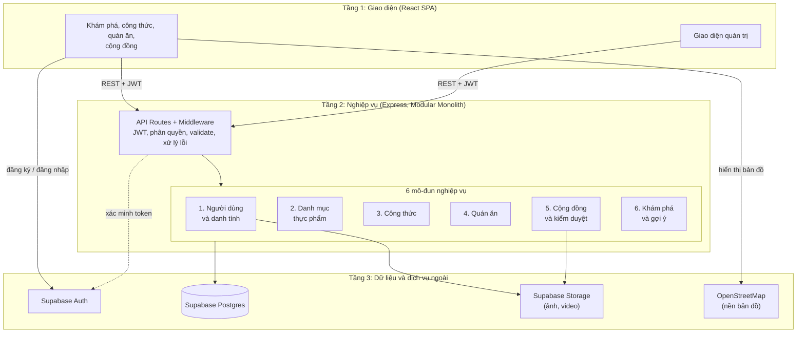
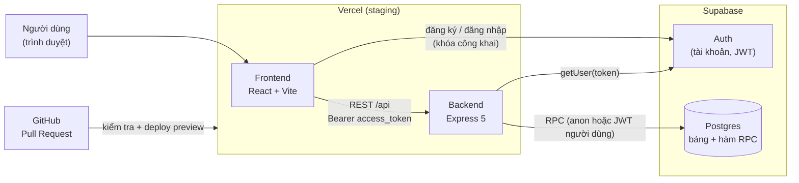
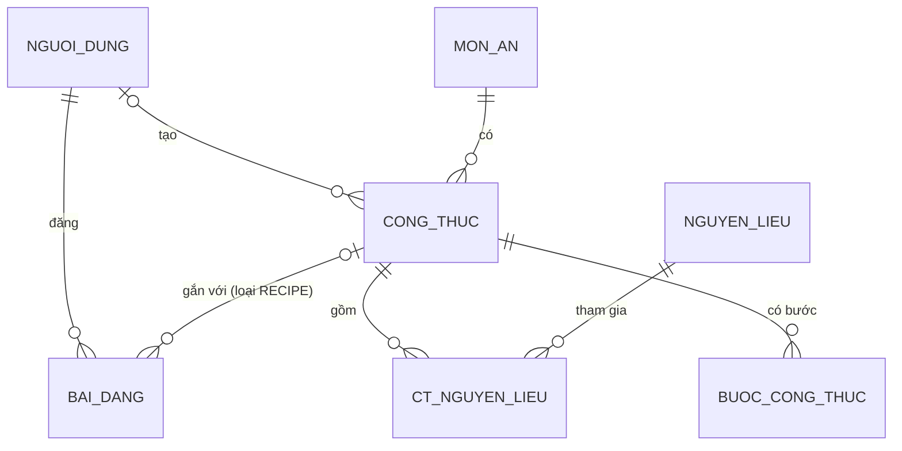
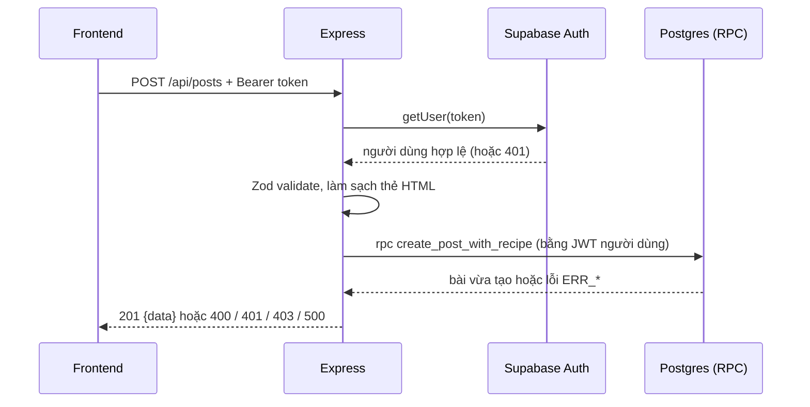
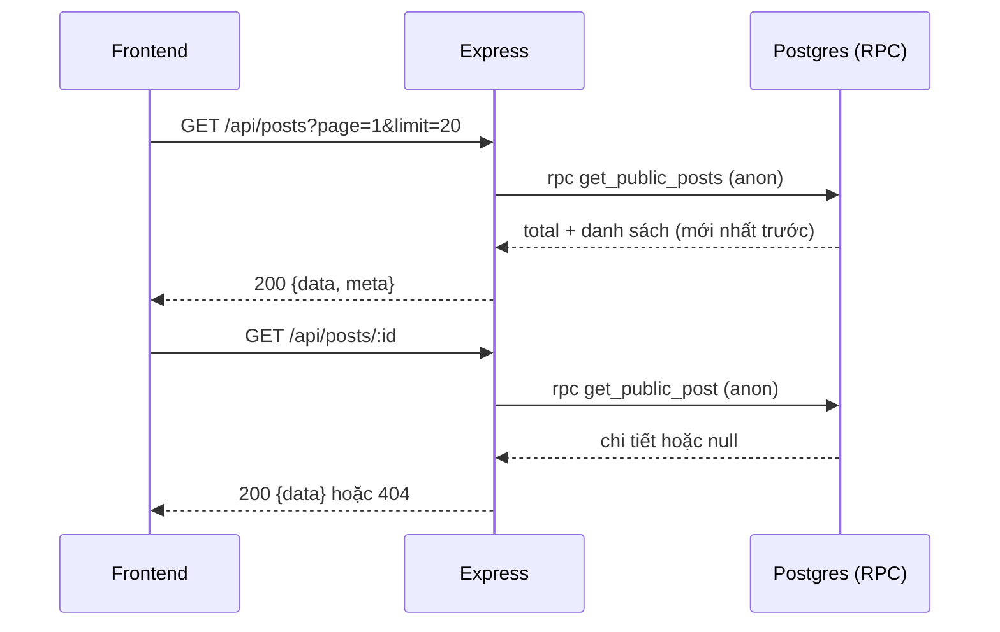

# Tài liệu kiến trúc: "Hôm nay ăn gì?"

> Cập nhật lần đầu: 11/11/2026 (Sprint 1). Người viết: TV1. Công việc: DOC01.

## Mục lục

1. Mục đích và cách đọc tài liệu
2. Tài liệu liên quan
3. Tóm tắt sản phẩm
4. Kiến trúc đích của cả dự án
5. Kiến trúc đã có ở Sprint 1
6. Công nghệ và phiên bản
7. Cấu trúc repo
8. Backend chi tiết
9. Xác thực và phân quyền
10. Dữ liệu (phần 2)
11. API (phần 2)
12. Các luồng chính chi tiết (phần 2)
13. Frontend (phần 2)
14. Môi trường, triển khai, CI (phần 2)
15. Quy ước phát triển và cách thêm một API mới (phần 2)
16. Lộ trình các mô-đun theo Sprint (phần 2)
17. Quyết định kiến trúc và lý do (phần 2)
18. Bảo mật và kiểm thử (phần 2)
19. Rủi ro, nợ kỹ thuật, việc chưa làm (phần 2)
20. Thuật ngữ (phần 2)

---

## 1. Mục đích và cách đọc tài liệu

Tài liệu trả lời ba câu hỏi:

1. Hệ thống gồm những phần nào và chúng nói chuyện với nhau ra sao?
2. Việc nào thuộc frontend, backend, hay làm trực tiếp trên Supabase?
3. Khi cần thêm tính năng, đặt code ở đâu và theo quy tắc nào?

Cách đọc theo vai trò:

| Bạn là | Đọc trước | Đọc khi cần |
|---|---|---|
| Thành viên mới | Mục 3, 4, 5, 7 | Mục 15 trước khi viết code |
| Frontend (TV2) | Mục 9, 11, 12, 13 | Mục 14 (CORS, biến môi trường) |
| Backend (TV1, TV4) | Mục 8, 9, 15 | Mục 10, 11 |
| Database (TV3) | Mục 10, 9 | Mục 17, 19 |
| DevOps/QA (TV5) | Mục 14, 18 | Mục 19 |

Quy ước nhãn trạng thái dùng trong tài liệu:

- **[Đã có]**: đã có code hoặc cấu hình trong repo (có thể còn chờ merge).
- **[Dự kiến]**: nằm trong kế hoạch Sprint, chưa làm.
- **[Chưa xác nhận]**: cần người khác (thường là TV3 hoặc TV5) xác nhận.

## 2. Tài liệu liên quan

| Tài liệu | Nội dung |
|---|---|
| [ERD và quy tắc nghiệp vụ](./erd.md) | Sơ đồ 18 bảng Supabase, quy tắc nghiệp vụ, ràng buộc (TV3 lập, bản gốc lưu trên Supabase) |
| [API contract](./api.md) | Request/response, mã lỗi, phân trang của từng endpoint |
| [Ghi chú schema](./schema-notes.md) | Ánh xạ tên bảng/cột thật với trường JSON của API |
| [README gốc](../README.md) | Cài đặt, chạy FE/BE, biến môi trường, deploy Vercel |
| [README backend](../backend/README.md) | Chạy và kiểm thử backend |
| Proposal và Báo cáo 2 của nhóm | Bài toán, user story F01–F26, quy định nghiệp vụ QĐ 1.1–5.8, use case. Không nằm trong repo |

Khi tài liệu này và API contract mâu thuẫn, **API contract thắng** về hình dạng request/response; tài liệu này thắng về cấu trúc và quy ước code.

## 3. Tóm tắt sản phẩm

"Hôm nay ăn gì?" là ứng dụng web giúp người dùng quyết định ăn gì: tìm món, **tự nấu** (xem công thức) hoặc **ăn ngoài** (xem quán), chia sẻ công thức và đánh giá quán trong cộng đồng, và gợi ý món theo nguyên liệu sẵn có.

**Ba tác nhân:**

| Tác nhân | Làm được gì |
|---|---|
| Khách truy cập | Xem nội dung công khai: bảng tin, món, công thức, quán |
| Người dùng đã đăng ký | Thêm: đăng bài, bình luận, lưu món, thêm quán, báo cáo vi phạm |
| Quản trị viên | Kiểm duyệt (ẩn nội dung), khóa/mở khóa tài khoản |

"Chủ sở hữu quán" **không phải vai trò tài khoản**: đó là quyền gắn với từng quán do người dùng tạo (QĐ 2.3).

**Năm nhóm chức năng** (user story F01–F26): (1) gợi ý món và tra cứu công thức, (2) gợi ý địa điểm, (3) cộng đồng, (4) gợi ý theo nguyên liệu, (5) tài khoản, phân quyền, quản trị.

**Phạm vi Sprint 1 (28/10 – 08/11/2026, kéo dài thực tế đến khi nghiệm thu):**

- Có: đăng ký, đăng nhập, đăng xuất; đăng bài công thức **có cấu trúc** (phương án A); xem bảng tin công khai; dataset mẫu và tra cứu món theo tên.
- Chưa có (vẫn trong backlog): video/ảnh, lưu nháp, sửa/xóa bài, like, bình luận, báo cáo, gợi ý theo nguyên liệu hoàn chỉnh, bản đồ, quán ăn.

**Các quy định nghiệp vụ ảnh hưởng trực tiếp đến kiến trúc:**

| Quy định | Hệ quả kỹ thuật |
|---|---|
| QĐ 3.3, 5.5: nội dung vi phạm được **ẩn, không xóa vĩnh viễn** | Dùng cột `trang_thai` (`PUBLIC`, `HIDDEN`, `DELETED`); mọi truy vấn công khai phải lọc theo trạng thái |
| QĐ 4.4: công thức thiếu thành phần phải đánh dấu | Cột `cong_thuc.trang_thai_thanh_phan` (`COMPLETE`, `INCOMPLETE`) |
| QĐ 2.3: quyền quản lý theo từng quán | Kiểm tra quyền theo **tài nguyên** ở backend, không dựa vào vai trò toàn cục |
| NFR03: phân quyền kiểm tra phía máy chủ | Không chỉ ẩn nút ở giao diện; backend và DB phải tự từ chối |
| QĐ 5.5: quản trị do hệ thống cấp | Không có API đăng ký admin; vai trò `ADMIN` đặt thủ công trong DB |

## 4. Kiến trúc đích của cả dự án

Theo proposal: kiến trúc **Client–Server 3 tầng**, backend là **Modular Monolith** (một ứng dụng Express, chia 6 mô-đun theo nghiệp vụ, **không phải microservice**).



**Trách nhiệm của 6 mô-đun** (ranh giới nghiệp vụ, không nhất thiết là 6 thư mục):

| # | Mô-đun | Trách nhiệm | Bảng chính |
|---|---|---|---|
| 1 | Người dùng và danh tính | Hồ sơ, sở thích, món yêu thích, dị ứng/kiêng kỵ, vai trò | `nguoi_dung`, `so_thich_nguoi_dung`, `mon_yeu_thich`, `han_che_nguyen_lieu` |
| 2 | Danh mục thực phẩm | Món ăn, nguyên liệu, thuộc tính món; chuẩn hóa dữ liệu dùng chung | `mon_an`, `nguyen_lieu`, `thuoc_tinh_mon`, `mon_an_thuoc_tinh` |
| 3 | Công thức | Công thức, nguyên liệu kèm định lượng, các bước, thời gian | `cong_thuc`, `ct_nguyen_lieu`, `buoc_cong_thuc` |
| 4 | Quán ăn | Quán, vị trí, thực đơn, giá, quyền quản lý quán | `quan_an`, `thuc_don` |
| 5 | Cộng đồng và kiểm duyệt | Bài đăng, bình luận, cảm xúc, tệp đính kèm, báo cáo, ẩn nội dung | `bai_dang`, `binh_luan`, `cam_xuc`, `tep_dinh_kem`, `bao_cao` |
| 6 | Khám phá và gợi ý | Tìm kiếm, lọc, gợi ý theo sở thích và theo nguyên liệu, tính độ khớp | Đọc từ các bảng của mô-đun 1–4 |

**Quy tắc phụ thuộc giữa các mô-đun** (theo proposal): mô-đun 6 đọc dữ liệu của 1, 2, 3, 4; mô-đun 3 và 4 dùng danh mục của mô-đun 2; mô-đun 5 liên kết tới công thức (3) và quán (4). Mô-đun này **không tự ý ghi vào bảng của mô-đun khác**; cần thì gọi qua service của mô-đun đó.

## 5. Kiến trúc đã có ở Sprint 1



- Staging frontend: `<điền sau>`
- Staging backend: `<điền sau>`

**Mỗi mô-đun đang ở đâu:**

| Mô-đun | Ở Sprint 1 | Trạng thái |
|---|---|---|
| 1. Người dùng, danh tính | Đăng ký/đăng nhập qua Supabase Auth; middleware `requireAuth`; trigger `create_user_profile` tạo hồ sơ. Chưa có API hồ sơ, sở thích, yêu thích | Một phần |
| 2. Danh mục thực phẩm | `GET /api/dishes` (tìm theo tên, lọc `ingredients`), TV4 phụ trách (BE05, BE06) | Đang làm / [Dự kiến] |
| 3. Công thức | Chưa có API riêng. Công thức được **tạo cùng bài đăng** trong hàm RPC `create_post_with_recipe` và **đọc cùng bài đăng** trong `get_public_post` | Một phần |
| 4. Quán ăn | Chưa có | [Dự kiến] Sprint 3–4 |
| 5. Cộng đồng, kiểm duyệt | `POST /api/posts`, `GET /api/posts`, `GET /api/posts/:id` (BE03, BE04). Chưa có tương tác, báo cáo, kiểm duyệt | Một phần |
| 6. Khám phá, gợi ý | Thử nghiệm lọc món theo nguyên liệu trong BE06 (ưu tiên P1) | [Dự kiến] Sprint 3 |

Hệ quả cho cách viết code: Sprint 1 **tổ chức code theo tài nguyên** (`posts`, `dishes`), không theo 6 mô-đun. Mỗi tài nguyên gồm 4 file `routes`, `controller`, `service`, `schema`. Khi thêm tài nguyên mới, xem mục 15 để biết nó thuộc mô-đun nào.

## 6. Công nghệ và phiên bản

| Phần | Công nghệ | Ghi chú |
|---|---|---|
| Giao diện | React 19, Vite 8, `@supabase/supabase-js` 2 | Lint bằng `oxlint`. **Tailwind CSS chưa được cài** dù proposal dự kiến dùng; hiện dùng CSS thường (`App.css`, `index.css`) |
| Backend | Node.js 22.12+ (khuyến nghị 24), Express 5, ESM (`"type": "module"`) | `helmet` (header bảo mật), `cors`, `dotenv` |
| Validation | Zod 3 | Dùng ở controller (`schemas/`) và để kiểm tra biến môi trường |
| Kiểm thử backend | Vitest 3 + Supertest 7; lint bằng ESLint 9 | Chạy trong `backend/` |
| Dữ liệu | Supabase (PostgreSQL), Supabase Auth | Bảng và cột đặt tên tiếng Việt không dấu |
| Triển khai | Vercel, **2 project** (frontend, backend) | Express được export qua `backend/index.js` |
| CI | Kiểm tra của Vercel trên mỗi Pull Request | **Chưa có GitHub Actions** (`.github/workflows/`), xem mục 14 và 19 |
| Dự kiến nhưng chưa dùng | Supabase Storage (ảnh/video), OpenStreetMap | Sprint 2 trở đi |

## 7. Cấu trúc repo

```
NMCNPM-Lab/
├── backend/
│   ├── index.js                  # export app cho Vercel (không gọi listen)
│   ├── src/
│   │   ├── server.js             # app.listen: chỉ dùng khi chạy local
│   │   ├── app.js                # createApp(): gắn middleware + router
│   │   ├── config/env.js         # đọc và validate biến môi trường bằng Zod
│   │   ├── lib/supabase.js       # tạo Supabase client (anon, user)
│   │   ├── middleware/
│   │   │   ├── auth.js           # requireAuth: xác minh Bearer token
│   │   │   ├── errorHandler.js   # xử lý lỗi tập trung
│   │   │   ├── notFound.js       # 404 cho route không tồn tại
│   │   │   └── requestLogger.js  # log "[HTTP] METHOD URL STATUS ms" (BE02)
│   │   ├── routes/               # index.js gom router; mỗi tài nguyên một file
│   │   ├── controllers/          # parse Zod, gọi service, trả status
│   │   ├── services/             # nơi DUY NHẤT gọi Supabase
│   │   ├── schemas/              # schema Zod: body, query, params
│   │   └── utils/                # AppError.js, pagination.js
│   └── tests/                    # Vitest + Supertest (mock Supabase)
├── frontend/
│   ├── src/lib/supabase.js       # Supabase client (chỉ khóa công khai)
│   ├── src/lib/api.js            # hàm gọi API backend kèm Bearer token
│   └── src/App.jsx, main.jsx     # giao diện (Sprint 1 còn gom trong App.jsx)
├── supabase/                     # SQL chạy trong Supabase SQL Editor
│   ├── seed.sql                  # dữ liệu mẫu món ăn
│   ├── create_post_with_recipe.sql   # hàm RPC đăng bài (BE03)
│   └── get_public_posts.sql          # hai hàm RPC xem bài (BE04)
└── docs/                         # api.md, architecture.md, erd.md, schema-notes.md
```

**Quy ước vị trí code:**

| Bạn cần | Đặt ở |
|---|---|
| Thêm endpoint mới | `routes/<tài-nguyên>.routes.js` (đã gắn vào `routes/index.js`) |
| Kiểm tra dữ liệu đầu vào | `schemas/<tài-nguyên>.schema.js` |
| Logic nghiệp vụ, gọi Supabase | `services/<tài-nguyên>.service.js` |
| Thay đổi cấu trúc DB hoặc hàm Postgres | File `.sql` trong `supabase/`, TV3 review |
| Biến môi trường mới | `config/env.js` **và** `.env.example` (cùng lúc) |

## 8. Backend chi tiết

### 8.1. Đường đi của một request

```
Trình duyệt
  → helmet (header bảo mật)
  → cors (origin lạ bị từ chối 403 FORBIDDEN)
  → requestLogger (log, tắt khi NODE_ENV=test)
  → express.json (giới hạn body 100kb)
  → /health hoặc /api/<tài-nguyên>
      → requireAuth (chỉ route cần đăng nhập)
      → controller: Zod parse → gọi service
      → service: gọi Supabase (RPC) → ném AppError nếu lỗi
  → notFound (route không tồn tại → 404)
  → errorHandler (mọi lỗi → JSON theo contract)
```

### 8.2. Trách nhiệm từng lớp (quy tắc bắt buộc)

| Lớp | Được làm | **Không** được làm |
|---|---|---|
| `routes` | Khai báo đường dẫn, gắn middleware (`requireAuth`) | Chứa logic, gọi Supabase |
| `controllers` | Parse đầu vào bằng Zod, gọi service, chọn status HTTP, trả JSON | Gọi Supabase trực tiếp; tự bắt lỗi rồi tự trả JSON lỗi (chuyển cho `next(err)`) |
| `services` | Gọi Supabase (RPC), ánh xạ lỗi DB sang `AppError` | Biết về `req`/`res`; đọc header hay body HTTP |
| `schemas` | Mô tả và làm sạch dữ liệu đầu vào (Zod) | Truy cập DB |
| `middleware` | Xác thực, log, xử lý lỗi | Chứa nghiệp vụ |

### 8.3. Hai loại Supabase client (`lib/supabase.js`)

| Hàm | Dùng cho | Khóa và danh tính |
|---|---|---|
| `getAnonClient()` | Đọc dữ liệu công khai; xác minh token (`auth.getUser`) | Khóa công khai (anon), một instance dùng chung |
| `createUserClient(accessToken)` | Ghi dữ liệu **nhân danh người dùng** (ví dụ đăng bài) | Khóa công khai + JWT người dùng, tạo mới mỗi request |

`SUPABASE_SERVICE_ROLE_KEY` **hiện chưa dùng**. Khóa này bỏ qua RLS, nên chỉ được thêm khi TV3 và TV1 thống nhất, chỉ ở backend, và không dùng cho request thông thường của người dùng.

### 8.4. Xử lý lỗi

Mọi lỗi đi qua `errorHandler.js` và trả về một dạng duy nhất:

```json
{ "error": { "code": "VALIDATION_ERROR", "message": "Dữ liệu không hợp lệ", "details": [{ "field": "ingredients[0].quantity", "message": "..." }] } }
```

| Nguồn lỗi | Kết quả |
|---|---|
| `ZodError` (dữ liệu sai) | 400 `VALIDATION_ERROR`, `details` liệt kê từng trường (`field` dạng `ingredients[0].quantity`) |
| JSON body sai cú pháp | 400 `VALIDATION_ERROR` |
| `AppError(status, code, message, details?)` | Đúng status và code đã ném. Dùng cho 401, 403, 404, và 400 nghiệp vụ |
| Lỗi RPC có mã `ERR_*` | Service ánh xạ sang `AppError` tương ứng (xem mục 12) |
| Lỗi không lường trước | 500 `INTERNAL_ERROR`, **không lộ chi tiết**; chi tiết chỉ ghi log phía server |

Mã lỗi chuẩn: `400 VALIDATION_ERROR`, `401 UNAUTHORIZED`, `403 FORBIDDEN`, `404 NOT_FOUND`, `500 INTERNAL_ERROR`.

### 8.5. Phân trang

Dùng `paginationQuerySchema` (`utils/pagination.js`) cho mọi API danh sách: `page` mặc định 1 (từ 1 đến 1.000.000), `limit` mặc định 20 (từ 1 đến 50). Kết quả trả về dạng `{ data: [...], meta: { page, limit, total } }`. Giá trị sai trả 400, **không tự sửa im lặng**.

### 8.6. Biến môi trường backend

Được đọc và kiểm tra bằng Zod khi khởi động (`config/env.js`). Thiếu hoặc sai biến thì server không chạy.

| Biến | Bắt buộc | Ý nghĩa |
|---|---|---|
| `SUPABASE_URL` | Có | URL project Supabase |
| `SUPABASE_ANON_KEY` | Có | Khóa công khai (anon/publishable) |
| `CORS_ORIGINS` | Có | Danh sách origin frontend được phép, ngăn cách bằng dấu phẩy, **không có dấu `/` ở cuối** |
| `PORT` | Không | Cổng chạy local, mặc định 3000 |
| `NODE_ENV` | Không | `development`, `production` hoặc `test` |
| `SUPABASE_SERVICE_ROLE_KEY` | Chưa dùng | Không commit, không đưa vào frontend |

Khi thêm biến mới, sửa **cả** `config/env.js` và `backend/.env.example`. `backend/.env` không bao giờ được commit.

## 9. Xác thực và phân quyền

### 9.1. Ai làm gì

| Bước | Thành phần | Ghi chú |
|---|---|---|
| Đăng ký, đăng nhập, đăng xuất, giữ phiên | **Frontend gọi trực tiếp Supabase Auth** | Dùng khóa công khai; backend không tham gia |
| Tạo hồ sơ `nguoi_dung` khi đăng ký | Trigger `create_user_profile` (TV3) | Frontend gửi `display_name` trong metadata của `signUp` |
| Gửi token | Frontend | Header `Authorization: Bearer <access_token>` |
| Xác minh token | Backend, `requireAuth` | Gọi `auth.getUser(token)`; thiếu hoặc sai token trả 401 |
| Biết người gọi là ai | Backend gán `req.auth = { userId, accessToken }` | `userId` chỉ lấy từ token |

### 9.2. Các lớp kiểm tra quyền

| Lớp | Kiểm tra gì | Sprint 1 |
|---|---|---|
| 1. Middleware `requireAuth` | Có token hợp lệ không (401) | [Đã có] |
| 2. Hàm RPC `SECURITY DEFINER` | Tài khoản `ACTIVE` (403), món `ACTIVE`; người đăng = `auth.uid()` | [Đã có] cho đăng bài |
| 3. Middleware vai trò (`ADMIN`) | Chỉ admin được kiểm duyệt, khóa tài khoản | [Dự kiến] Sprint 2 (BE07) |
| 4. Kiểm tra quyền theo tài nguyên | Chỉ người tạo quán sửa thực đơn quán đó | [Dự kiến] Sprint 4 |
| 5. RLS của Postgres | Chặn ở tầng DB nếu có ai gọi thẳng bằng khóa công khai | [Chưa xác nhận] (TV3) |

### 9.3. Quy tắc bắt buộc

1. **Không bao giờ** nhận `user_id` hay `author_id` từ body, query hay URL. Danh tính chỉ lấy từ token.
2. Không tin giao diện: nút bị ẩn không có nghĩa là thao tác bị chặn. Backend và DB phải tự từ chối (NFR03).
3. Route công khai (bảng tin, chi tiết bài) **không** gắn `requireAuth` và không bao giờ trả email hay dữ liệu riêng tư (`author` chỉ gồm `id` và `display_name`).
4. Tài khoản `LOCKED` không được ghi dữ liệu. Hiện hàm RPC đăng bài đã kiểm tra; Sprint 2 sẽ kiểm tra ở middleware cho mọi route.
5. Vai trò `ADMIN` chỉ được đặt thủ công trong DB, không có API tạo admin.
6. Xác nhận email khi đăng ký bật hay tắt là do TV3 quyết định ở DB06: `<điền sau>`.

---

## 10. Dữ liệu

### 10.1. Nguyên tắc

- Bảng và cột đặt tên **tiếng Việt không dấu**, `snake_case` (ví dụ `bai_dang`, `ma_tac_gia`). JSON của API dùng tên tiếng Anh `snake_case`; backend là nơi ánh xạ giữa hai bên (mục 10.3).
- Khóa chính là `bigint` tự tăng (`IDENTITY`), **riêng `nguoi_dung.ma_nd` là `uuid`** và trùng `auth.users.id`.
- Tất cả bảng bật RLS. Chính sách RLS cụ thể **[Chưa xác nhận]** (TV3), nên backend không đọc/ghi bảng trực tiếp mà đi qua **hàm RPC** (mục 10.4).
- Thời gian lưu `timestamptz`, API trả ISO 8601 UTC.
- Sơ đồ đầy đủ 18 bảng xem [ERD](./erd.md). Dưới đây chỉ là phần Sprint 1 sử dụng.

### 10.2. Các bảng Sprint 1 sử dụng



| Bảng | Khóa | Cột và ràng buộc quan trọng |
|---|---|---|
| `mon_an` | `ma_mon` | `ten_mon`, `mo_ta_ngan`, `hinh_anh`, `trang_thai` (`ACTIVE`, `HIDDEN`, `DELETED`) |
| `nguoi_dung` | `ma_nd` (uuid = `auth.users.id`) | `ten_hien_thi`, `anh_dai_dien`, `vai_tro` (`USER`, `ADMIN`), `trang_thai` (`ACTIVE`, `LOCKED`), `tao_luc`. **Không có email** |
| `bai_dang` | `ma_bai` | `ma_tac_gia` (FK uuid), `loai_bai` (`RECIPE`, `REVIEW`), `ma_ct` (FK, cho phép null), `ma_quan`, `ma_mon_da_dung`, `tieu_de`, `noi_dung` (bắt buộc), `gia_da_tra`, `trang_thai` (`DRAFT` là mặc định của DB, `PUBLIC`, `HIDDEN`, `DELETED`), `tao_luc`, `sua_luc`. Bài `RECIPE` **bắt buộc có `ma_ct`** |
| `cong_thuc` | `ma_ct` | `ma_mon` (FK), `ma_nguoi_tao` (uuid), `ten_ct`, `thoi_gian_phut`, `trang_thai_thanh_phan` (`COMPLETE`, `INCOMPLETE`), `tao_luc` |
| `ct_nguyen_lieu` | (`ma_ct`, `ma_nl`) | `so_luong` (số lớn hơn 0 hoặc null), `don_vi`, `vai_tro_nl` (`PRIMARY`, `SECONDARY`, mặc định `SECONDARY`), `ghi_chu` |
| `nguyen_lieu` | `ma_nl` | `ten_nl` **duy nhất** |
| `buoc_cong_thuc` | (`ma_ct`, `stt`) | `stt` lớn hơn 0, `noi_dung` không rỗng |

Quan hệ cần nhớ: một bài đăng công thức đi qua `bai_dang.ma_ct` → `cong_thuc` → `mon_an` để biết **món** nào. Cột `bai_dang.ma_mon_da_dung` dành cho bài đánh giá quán (món đã dùng), không dùng cho bài công thức.

### 10.3. Ánh xạ cột DB sang JSON của API

| JSON (API) | Nguồn trong DB |
|---|---|
| `id` (bài) | `bai_dang.ma_bai` |
| `title`, `content`, `created_at` | `bai_dang.tieu_de`, `noi_dung`, `tao_luc` |
| `dish.id`, `dish.name` | `mon_an.ma_mon`, `ten_mon` (qua `cong_thuc.ma_mon`) |
| `author.id`, `author.display_name` | `nguoi_dung.ma_nd`, `ten_hien_thi` |
| `ingredients[].ingredient_id`, `name` | `nguyen_lieu.ma_nl`, `ten_nl` |
| `ingredients[].quantity`, `unit`, `role` | `ct_nguyen_lieu.so_luong`, `don_vi`, `vai_tro_nl` |
| `steps[].order`, `content` | `buoc_cong_thuc.stt`, `noi_dung` |

Việc ánh xạ này nằm **bên trong hàm RPC** (hàm trả JSON đã đúng tên trường), nên service ở backend chỉ chuyển tiếp, không đổi tên trường.

### 10.4. Hàm Postgres (RPC) hiện có

File SQL nằm trong `supabase/`, chạy trong Supabase SQL Editor, viết dạng `create or replace` để chạy lại được.

| Hàm | Tham số | Trả về | Ai được gọi | Gọi từ |
|---|---|---|---|---|
| `create_post_with_recipe` | `p_dish_id bigint`, `p_title text`, `p_content text`, `p_ingredients jsonb`, `p_steps jsonb` | `jsonb`: bài vừa tạo (cùng dạng `GET /api/posts/:id`) | Chỉ role `authenticated` | `createPost` bằng `createUserClient(token)` |
| `get_public_posts` | `p_page int`, `p_limit int` | `jsonb`: `{ "total": n, "data": [ {id, title, created_at, dish, author} ] }`, mới nhất trước | `anon`, `authenticated` | `listPosts` bằng `getAnonClient()` |
| `get_public_post` | `p_id bigint` | `jsonb` chi tiết bài, hoặc `null` nếu không tồn tại hoặc không công khai | `anon`, `authenticated` | `getPostById` bằng `getAnonClient()` |

**Hành vi của `create_post_with_recipe`:**

1. Lấy người đăng bằng `auth.uid()`; không có thì ném `ERR_UNAUTHORIZED`.
2. Tài khoản phải `ACTIVE`, nếu không ném `ERR_FORBIDDEN`. Món phải `ACTIVE`, nếu không ném `ERR_DISH_NOT_FOUND`.
3. Nguyên liệu có `ingredient_id`: phải tồn tại (`ERR_INGREDIENT_NOT_FOUND`). Nguyên liệu gõ tay (`name`): khớp `ten_nl` không phân biệt hoa thường; chưa có thì tạo mới.
4. Nguyên liệu trùng trong cùng công thức: `ERR_INGREDIENT_DUPLICATE`.
5. Tạo theo thứ tự `cong_thuc` → `ct_nguyen_lieu` → `buoc_cong_thuc` → `bai_dang` trong **một transaction**. Bài luôn có `loai_bai = RECIPE`, `trang_thai = PUBLIC`; `content` trống thì lấy `title`.

**Quy tắc khi viết hoặc sửa hàm RPC:**

1. Hàm `SECURITY DEFINER` bỏ qua RLS, nên **bắt buộc** có `set search_path = public`, tự kiểm tra quyền trong thân hàm, và chỉ `grant execute` cho role cần thiết.
2. Hàm đọc công khai chỉ trả bài `RECIPE` + `PUBLIC`, không trả email hay cột nội bộ.
3. Lưu file `.sql` trong `supabase/` và nhờ TV3 review trước khi merge.
4. Đổi chữ ký hàm (tên, tham số, kiểu trả về) là đổi contract giữa backend và DB: báo TV1 và TV3, cập nhật service cùng lúc.

## 11. API

Chi tiết từng endpoint xem [API contract](./api.md). Dưới đây là bản tổng hợp để định hướng.

| Method | Đường dẫn | Đăng nhập | Phụ trách | Mô tả |
|---|---|---|---|---|
| GET | `/health`, `/api/health` | Không | TV1 | Kiểm tra server sống (`{"status":"ok"}`) |
| POST | `/api/posts` | **Có** | TV1 (BE03) | Đăng bài công thức có cấu trúc; trả 201 kèm bài vừa tạo |
| GET | `/api/posts` | Không | TV1 (BE04) | Bảng tin: bài `RECIPE` + `PUBLIC`, mới nhất trước, có phân trang |
| GET | `/api/posts/:id` | Không | TV1 (BE04) | Chi tiết bài: `content`, nguyên liệu, các bước theo thứ tự |
| GET | `/api/dishes` | Không | TV4 (BE05, BE06) | Tra cứu món `ACTIVE` theo tên, lọc theo `ingredients`, có phân trang |

**Quy ước chung:**

- Base URL dev: `http://localhost:3000`. Token: `Authorization: Bearer <access_token>`.
- Thành công: `{ "data": ... }` hoặc `{ "data": [...], "meta": { "page", "limit", "total" } }`. Lỗi: xem mục 8.4.
- ID trong API là **số nguyên** (`"id": 17`); riêng `author.id` là UUID.
- Danh sách rỗng trả `200` với `"data": []`, **không** trả 404.
- Đổi contract phải báo trước TV1 và TV2, rồi ghi vào mục "Lịch sử thay đổi" trong `api.md`.

**Request `POST /api/posts` (tóm tắt):**

| Trường | Quy tắc |
|---|---|
| `dish_id` | Số nguyên dương, món phải tồn tại và `ACTIVE` |
| `title` | 3 đến 150 ký tự |
| `content` | Không bắt buộc, 1 đến 2000 ký tự; bỏ trống thì lấy `title` |
| `ingredients` | 1 đến 50 phần tử. Mỗi phần tử có `ingredient_id` **hoặc** `name` (tối đa 100 ký tự), `quantity` (lớn hơn 0 hoặc `null`), `unit` (tối đa 30 ký tự hoặc `null`), `role` (`PRIMARY` hoặc `SECONDARY`, mặc định `SECONDARY`). Nguyên liệu trùng bị từ chối |
| `steps` | 1 đến 50 phần tử, mỗi phần tử `{ "content": "..." }` tối đa 1000 ký tự; thứ tự là thứ tự trong mảng |

Dữ liệu chữ được làm sạch (bỏ thẻ HTML, ký tự điều khiển, cắt khoảng trắng). Trường lạ như `author_id` bị bỏ qua.

## 12. Các luồng chính chi tiết

### 12.1. Đăng ký và đăng nhập (frontend làm việc với Supabase Auth)

```mermaid
sequenceDiagram
    actor U as Người dùng
    participant FE as Frontend
    participant AU as Supabase Auth
    participant DB as Postgres
    U->>FE: Nhập email, mật khẩu (đăng ký thêm tên hiển thị)
    FE->>AU: signUp (kèm display_name) hoặc signInWithPassword
    AU->>DB: Trigger create_user_profile tạo nguoi_dung (khi đăng ký)
    AU-->>FE: session chứa access_token (hoặc lỗi)
    FE->>FE: Giữ phiên; tải lại trang vẫn đăng nhập
    Note over FE,AU: Backend không tham gia luồng này
```

Frontend phải xử lý: email trùng, sai mật khẩu, email sai định dạng, mật khẩu ngắn, và (nếu bật xác nhận email) trạng thái "chưa có session, cần xác nhận email". Thông báo lỗi hiển thị bằng tiếng Việt.

### 12.2. Đăng bài (`POST /api/posts`)



| Tình huống | Nơi phát hiện | Kết quả |
|---|---|---|
| Thiếu header, sai định dạng `Bearer`, token sai hoặc hết hạn | `requireAuth` | 401 `UNAUTHORIZED` |
| Dữ liệu sai (thiếu trường, quá dài, định lượng không hợp lệ, nguyên liệu trùng, quá 50 phần tử...) | Zod ở controller | 400 `VALIDATION_ERROR`, `details[].field` chỉ rõ trường |
| `ERR_UNAUTHORIZED` | RPC | 401 `UNAUTHORIZED` |
| `ERR_FORBIDDEN` (tài khoản không `ACTIVE`) | RPC | 403 `FORBIDDEN` |
| `ERR_DISH_NOT_FOUND` | RPC | 400, field `dish_id` |
| `ERR_INGREDIENT_NOT_FOUND`, `ERR_INGREDIENT_DUPLICATE` | RPC | 400, field `ingredients` |
| Lỗi khác từ DB | Service | 500 `INTERNAL_ERROR` (không lộ chi tiết) |

Vì toàn bộ việc ghi nằm trong một lệnh RPC (một transaction), lỗi giữa chừng **không để lại dữ liệu dở dang**; backend không bao giờ ghi lẻ từng bảng.

**Frontend nên:** khi 401 thì chuyển về đăng nhập; khi 400 thì hiện lỗi cạnh đúng ô theo `details[].field` (ví dụ `ingredients[0].quantity`); khi lỗi thì **giữ nguyên dữ liệu người dùng đã nhập**.

### 12.3. Xem bảng tin và chi tiết bài (công khai)



| Tình huống | Kết quả |
|---|---|
| `page` hoặc `limit` sai (`page=0`, `limit=100`, chữ...) | 400 `VALIDATION_ERROR`, không gọi DB |
| `:id` không phải số nguyên dương (`abc`, `0`, `-1`, UUID, quá 15 chữ số) | 400 `VALIDATION_ERROR`, field `id` |
| Bài không tồn tại, hoặc không phải `RECIPE` + `PUBLIC` | 404 `NOT_FOUND` |
| Lỗi RPC | 500 `INTERNAL_ERROR` |

Hai endpoint này **không cần token**; gửi token cũng không làm kết quả đổi.

## 13. Frontend

### 13.1. Hiện trạng Sprint 1

- Toàn bộ giao diện đang nằm trong `src/App.jsx` (đăng ký/đăng nhập/đăng xuất, giữ phiên, danh sách món). Chưa có router, chưa có trang bảng tin, chi tiết bài, form tạo bài.
- `src/lib/supabase.js`: tạo Supabase client **chỉ khi** có `VITE_SUPABASE_URL` và `VITE_SUPABASE_PUBLISHABLE_KEY`.
- `src/lib/api.js`: hàm `api(path, token, signal)` gọi `${VITE_API_URL}/api${path}`, gắn `Authorization: Bearer` nếu có token.
- Vite chuyển tiếp `/api` sang `http://localhost:3000` khi chạy local (`vite.config.js`).

### 13.2. Quy tắc

1. Chỉ dùng **khóa công khai** (publishable/anon). Không đưa `service role` vào bất kỳ biến `VITE_`.
2. Supabase client ở frontend **chỉ dùng cho Auth**. Mọi dữ liệu bài viết, món ăn lấy qua `api.js`.
3. Token lấy từ `session.access_token` của Supabase, gửi qua `api.js`; không tự lưu token vào `localStorage`.
4. Hiển thị đủ các trạng thái: đang tải, rỗng, lỗi (NFR07). Lỗi hiển thị bằng tiếng Việt, đọc từ `error.message` và `error.details` của backend.

### 13.3. Routing dự kiến (FE01, FE04, FE05)

| Đường dẫn | Trang | Cần đăng nhập |
|---|---|---|
| `/` | Bảng tin (`GET /api/posts`) | Không |
| `/login`, `/register` | Đăng nhập, đăng ký | Không |
| `/posts/new` | Form tạo bài | **Có** (guard chuyển về `/login`) |
| `/posts/:id` | Chi tiết bài | Không |

### 13.4. Chỗ frontend đang lệch contract (TV2 cần sửa khi nối API thật)

| Hiện tại | Contract |
|---|---|
| `api.js` ném lỗi bằng `body?.error` (coi là chuỗi) | `error` là object `{ code, message, details? }`; phải đọc `body.error.message` |
| `App.jsx` gọi `/me` | `/api/me` đã không còn ở backend mới |
| `App.jsx` đọc món dạng mảng với `ma_mon`, `ten_mon` | `/api/dishes` trả `{ data: [{ id, name, description, image_url }], meta }` |
| Giao diện và thông báo tiếng Anh | Thông báo lỗi dành cho người dùng cần tiếng Việt |

Gợi ý `api.js` đọc đúng contract lỗi:

```js
export async function api(path, token, signal, options = {}) {
  const base = (import.meta.env.VITE_API_URL || '').replace(/\/$/, '')
  const res = await fetch(`${base}/api${path}`, {
    ...options,
    headers: {
      ...(options.body ? { 'Content-Type': 'application/json' } : {}),
      ...(token ? { Authorization: `Bearer ${token}` } : {}),
    },
    signal,
  })
  const body = await res.json().catch(() => null)
  if (!res.ok) {
    const err = new Error(body?.error?.message || `Yêu cầu thất bại (${res.status})`)
    err.status = res.status
    err.code = body?.error?.code
    err.details = body?.error?.details || []
    throw err
  }
  return body // dạng { data, meta? }; nơi gọi dùng body.data
}
```

## 14. Môi trường, triển khai, CI

### 14.1. Chạy local

| Thành phần | Lệnh (trong thư mục tương ứng) | Địa chỉ |
|---|---|---|
| Backend | `npm ci`, rồi `npm run dev` | `http://localhost:3000` |
| Frontend | `npm ci`, rồi `npm run dev` | `http://localhost:5173` |

Tạo `backend/.env` từ `backend/.env.example` và `frontend/.env.local` từ `frontend/.env.example`. Nếu `.env` cũ còn `PORT=4000`, đổi về 3000 hoặc sửa proxy trong `frontend/vite.config.js` cho khớp. Cả hai file này **không được commit**. Hướng dẫn đầy đủ xem [README gốc](../README.md).

### 14.2. Biến môi trường frontend

| Biến | Ý nghĩa |
|---|---|
| `VITE_SUPABASE_URL` | URL project Supabase |
| `VITE_SUPABASE_PUBLISHABLE_KEY` | Khóa công khai (publishable hoặc anon) |
| `VITE_API_URL` | Để trống khi chạy local (dùng proxy của Vite). Trên Vercel: **origin HTTPS của backend**, không có dấu `/` ở cuối |

Biến backend xem mục 8.6.

### 14.3. Staging trên Vercel (2 project, cùng một repo)

| | Frontend | Backend |
|---|---|---|
| Root Directory | `frontend` | `backend` |
| Framework | Vite | Express |
| Build | `npm run build` (output `dist`) | Không cần build; `backend/index.js` export app Express |
| Biến môi trường | `VITE_SUPABASE_URL`, `VITE_SUPABASE_PUBLISHABLE_KEY`, `VITE_API_URL` | `SUPABASE_URL`, `SUPABASE_ANON_KEY`, `CORS_ORIGINS` |
| URL | `<điền sau>` | `<điền sau>` |

Lưu ý khi cấu hình:

1. `CORS_ORIGINS` của backend phải chứa **đúng** origin frontend (HTTPS, không dấu `/` cuối). Origin lạ bị trả 403.
2. Trong Supabase → Authentication → URL Configuration: thêm `http://localhost:5173` và URL frontend staging vào danh sách redirect, đặt Site URL cho môi trường staging.
3. Mỗi URL **preview** của Pull Request là một origin khác: muốn bản preview gọi được backend thì cần thêm origin đó vào `CORS_ORIGINS` và Supabase redirect.
4. Đổi biến môi trường xong phải **redeploy**.
5. README gốc hiện còn ghi tên biến cũ (`SUPABASE_SERVICE_ROLE_KEY`, `FRONTEND_ORIGIN`). Tên đúng theo code là `SUPABASE_ANON_KEY` và `CORS_ORIGINS` (xem mục 19).

### 14.4. CI

- **Hiện có:** kiểm tra của Vercel chạy trên mỗi Pull Request (build và deploy preview).
- **Chưa có:** GitHub Actions (`.github/workflows/`). Công việc DO02 (TV5) cần tạo workflow chạy trên mỗi Pull Request:

| Thư mục | Lệnh |
|---|---|
| `backend/` | `npm ci`, `npm run lint`, `npm test` |
| `frontend/` | `npm ci`, `npm run lint`, `npm run build` |

Khóa bí mật khai báo trong **Secrets của repo**, không viết trong file workflow. Backend test dùng mock nên **không cần** khóa Supabase thật (khi `NODE_ENV=test` có giá trị giả cho các biến bắt buộc).

### 14.5. Quy trình làm việc với Git

| Quy ước | Nội dung |
|---|---|
| Nhánh | Mỗi subtask một nhánh: `feature/<MÃ>-<mô-tả-ngắn>` (ví dụ `feature/BE04-get-posts`) |
| Commit | `type(scope): mô tả bằng tiếng Anh` (ví dụ `feat(posts): implement POST /api/posts with transactional RPC`) |
| Pull Request | Tiêu đề và mô tả bằng tiếng Việt, tiêu đề bắt đầu bằng mã công việc: `[BE04] ...`. Mô tả có mục **Kết quả kiểm tra** (thay cho ảnh chụp: ghi status, số liệu, kết quả Postman/curl) |
| Review | Ít nhất 1 người review chéo (gợi ý: TV1↔TV3, TV2↔TV5, TV4↔TV3); CI không lỗi mới merge |
| Bí mật | Không commit `.env`, token, `SUPABASE_SERVICE_ROLE_KEY` |

## 15. Quy ước phát triển và cách thêm một API mới

### 15.1. Quy ước đặt tên

| Đối tượng | Quy ước |
|---|---|
| File | `<tài-nguyên>.<lớp>.js` (ví dụ `posts.service.js`, `dishes.routes.js`) |
| Import | ESM, **có đuôi `.js`** (`import ... from '../utils/AppError.js'`) |
| Trường JSON | `snake_case` tiếng Anh; ID số nguyên |
| Mã lỗi (`code`) | Tiếng Anh, `IN_HOA_GẠCH_DƯỚI` |
| Thông báo lỗi (`message`) | Tiếng Việt, dễ hiểu với người dùng, không lộ chi tiết nội bộ |
| Hàm RPC | `snake_case`, tham số bắt đầu bằng `p_` |

### 15.2. Các bước thêm một endpoint

1. **Contract trước:** thêm hoặc sửa mục trong `docs/api.md`, báo TV1 và TV2.
2. **Database (nếu cần):** viết hàm RPC trong `supabase/<tên>.sql`, chạy trên Supabase, nhờ TV3 review.
3. **Schema:** `schemas/<tài-nguyên>.schema.js` cho body, query, params (tái dùng `paginationQuerySchema` cho danh sách).
4. **Service:** gọi RPC, ánh xạ lỗi sang `AppError`.
5. **Controller:** parse bằng Zod, gọi service, chọn status.
6. **Route:** thêm vào `routes/<tài-nguyên>.routes.js`; thêm `requireAuth` nếu cần đăng nhập. Tài nguyên mới thì gắn vào `routes/index.js`.
7. **Test:** thêm test trong `tests/` (mục 18.2).
8. **Kiểm tra:** `npm run lint`, `npm test`, rồi gọi thử với Supabase thật.
9. **Pull Request:** theo mục 14.5.

### 15.3. Mẫu code

Service:

```js
import { getAnonClient } from '../lib/supabase.js';
import { AppError } from '../utils/AppError.js';

export async function listThings({ page, limit }) {
  const { data, error } = await getAnonClient().rpc('get_public_things', { p_page: page, p_limit: limit });
  if (error || !data) {
    console.error('[THINGS SERVICE ERROR - listThings]', error);
    throw new AppError(500, 'INTERNAL_ERROR', 'Đã xảy ra lỗi hệ thống khi tải danh sách');
  }
  return { data: data.data ?? [], meta: { page, limit, total: Number(data.total) } };
}
```

Controller và route:

```js
export async function listThingsHandler(req, res, next) {
  try {
    const query = listThingsQuerySchema.parse(req.query);
    return res.status(200).json(await thingsService.listThings(query));
  } catch (err) {
    return next(err); // không tự trả JSON lỗi; để errorHandler xử lý
  }
}

thingsRouter.get('/', listThingsHandler);                // công khai
thingsRouter.post('/', requireAuth, createThingHandler); // cần đăng nhập
```

### 15.4. Không làm

- Không gọi Supabase trong controller hoặc route.
- Không nhận `user_id` từ client.
- Không trả lỗi tùy ý (`res.status(...).json({ message })`); luôn ném `AppError` hoặc để Zod ném.
- Không ghi nhiều bảng bằng nhiều lệnh riêng khi cần nhất quán; dùng một hàm RPC (một transaction).
- Không thêm `console.log` token, mật khẩu hay khóa vào log.
- Không đổi contract mà không báo trước.

## 16. Lộ trình các mô-đun theo Sprint

Sprint 2–4 là **kế hoạch đề xuất**, PO điều chỉnh tại Sprint Planning.

| Mô-đun | Sprint 2 (09–22/11) | Sprint 3 (23/11–06/12) | Sprint 4 (07–20/12) |
|---|---|---|---|
| 1. Người dùng, danh tính | BE07 phân quyền vai trò ở middleware | Sở thích, món yêu thích, dị ứng/kiêng kỵ (phục vụ gợi ý) | Hoàn thiện |
| 2. Danh mục thực phẩm | BE09 tìm kiếm, lọc món; DB10 hoàn thiện dữ liệu | DB13 chuẩn hóa nguyên liệu, từ đồng nghĩa | Bổ sung dữ liệu |
| 3. Công thức | BE11 xem công thức chi tiết | Dùng cho gợi ý | Hoàn thiện |
| 4. Quán ăn | | DB14 dữ liệu quán mẫu, bản đồ nền | BE17 nghiệp vụ quán và quyền chủ quán; BE18 API quán |
| 5. Cộng đồng, kiểm duyệt | BE08 báo cáo và kiểm duyệt; BE10 tương tác bài viết; DB11 RLS | | Đánh giá quán |
| 6. Khám phá, gợi ý | | BE12 tích hợp API gợi ý; BE14 đối sánh nguyên liệu; BE15 xếp hạng; BE16 lọc dị ứng | BE19 ổn định |

**Thay đổi kiến trúc cần quyết định khi tới Sprint 2:**

1. **Thư mục theo mô-đun:** nếu mỗi lớp (`routes`, `services`...) có nhiều file, cân nhắc nhóm theo mô-đun (ví dụ `services/community/`). Đây chỉ là đề xuất, chốt tại Sprint Planning.
2. **Supabase Storage** cho ảnh, video (QĐ 5.8: `.jpg`, `.png`, `.webp`, `.mp4`, có giới hạn dung lượng): chưa được xếp lịch trong Sprint 1–2, cần quyết định.
3. **Middleware vai trò và trạng thái tài khoản** áp cho mọi route cần đăng nhập, thay vì chỉ kiểm tra trong từng hàm RPC.

## 17. Quyết định kiến trúc và lý do

| # | Quyết định | Lý do | Đánh đổi |
|---|---|---|---|
| 1 | **Phương án A: bài đăng có cấu trúc** (món, tiêu đề, nguyên liệu kèm định lượng và đơn vị, các bước) | Bài cộng đồng là nguồn dữ liệu cho tra cứu và gợi ý theo nguyên liệu (QĐ 3.1, F17 đến F19); chỉ dữ liệu có cấu trúc mới đối sánh được | Form đăng bài và validate phức tạp hơn so với bài văn bản tự do |
| 2 | **Modular Monolith** (một app Express, 6 mô-đun) | Theo proposal; nhóm 5 người, đồ án 8 tuần, không cần vận hành nhiều dịch vụ | Mô-đun phải tự giữ kỷ luật ranh giới (mục 4) |
| 3 | **Supabase Auth cấp JWT**; backend xác minh bằng `auth.getUser(token)` | Không tự quản lý mật khẩu; thu hồi phiên có hiệu lực ngay | Thêm một lần gọi mạng cho mỗi request cần đăng nhập. Proposal cho phép xác minh JWT cục bộ để giảm độ trễ, có thể đổi sau |
| 4 | **Frontend gọi trực tiếp Supabase chỉ cho Auth**; dữ liệu nghiệp vụ qua Express | Validate, mã lỗi và contract thống nhất một chỗ; RLS chưa xác nhận nên không để trình duyệt đọc/ghi bảng | Thêm một lớp backend phải deploy và bảo trì |
| 5 | **Đọc và ghi bài viết qua hàm RPC `SECURITY DEFINER`** | Transaction nhiều bảng; quyền kiểm tra ngay trong hàm; backend không phụ thuộc chi tiết RLS | Logic nằm cả ở SQL; cần TV3 review và quy tắc ở mục 10.4 |
| 6 | **Chỉ dùng khóa anon và JWT người dùng**; `service role` chưa dùng và chỉ ở backend nếu sau này cần | Khóa `service role` bỏ qua RLS, rủi ro cao nếu lộ | Một số thao tác quản trị (Sprint 2) có thể cần dùng, khi đó phải họp lại |
| 7 | **ID trong API là số nguyên**; `author.id` là UUID | Khớp schema Supabase thật (`bigint` và `uuid`) | Frontend không được giả định mọi ID là UUID |
| 8 | **Định dạng phản hồi thống nhất** (`data/meta`, `error{code,message,details}`) | Frontend xử lý một kiểu; QA kiểm thử dễ | Mọi endpoint mới phải tuân theo |
| 9 | **Validate và làm sạch bằng Zod ở backend** | Không tin dữ liệu từ client (NFR03) | Thêm schema cho mỗi endpoint |
| 10 | **Tách `app.js` (không `listen`) khỏi `server.js`** | Supertest gọi trực tiếp app; Vercel dùng `backend/index.js` | Không |
| 11 | **Hai project Vercel (frontend, backend) từ một repo** | Deploy độc lập, mỗi phía có biến môi trường riêng | Cần quản lý CORS và `VITE_API_URL` đúng |
| 12 | **Ẩn thay vì xóa vĩnh viễn** (trạng thái `HIDDEN`, `DELETED`) | QĐ 3.3, 5.5, NFR08: truy vết người xử lý, thời điểm, lý do | Mọi truy vấn công khai phải lọc theo `trang_thai` |
| 13 | **Phân trang bắt buộc, `limit` tối đa 50** | Tránh trả danh sách quá lớn | Frontend phải xử lý trang |

## 18. Bảo mật và kiểm thử

### 18.1. Bảo mật

| Biện pháp | Chi tiết |
|---|---|
| Header bảo mật | `helmet` |
| CORS | Danh sách cho phép (`CORS_ORIGINS`); origin lạ trả 403; request không có origin (curl, Postman, test) được chấp nhận |
| Giới hạn body | 100kb |
| Làm sạch dữ liệu | Bỏ thẻ HTML và ký tự điều khiển ở các trường chữ |
| Không lộ lỗi nội bộ | Lỗi 500 chỉ trả thông báo chung; chi tiết ghi log server |
| Nhật ký request | `requestLogger` chỉ ghi method, URL, status, thời gian; không ghi header hay body |
| Bí mật | `.env` nằm trong `.gitignore`; khóa anon/publishable là công khai, `service role` là bí mật tuyệt đối |
| Quyền | Danh tính chỉ từ token; kiểm tra quyền ở backend và hàm RPC (mục 9) |

### 18.2. Kiểm thử

- **Tự động** (`backend/`, `npm test`): Vitest + Supertest, **mock** `lib/supabase.js` nên không gọi Supabase thật và không cần khóa.

```js
vi.spyOn(supabaseLib, 'getAnonClient').mockReturnValue({
  rpc: vi.fn().mockResolvedValue({ data: { total: 0, data: [] }, error: null }),
});
const res = await request(createApp()).get('/api/posts');
expect(res.status).toBe(200);
```

- Mỗi endpoint nên có test: thành công, dữ liệu rỗng (nếu là danh sách), mỗi loại 400, 401/403 (nếu cần đăng nhập), 404, và 500 (không lộ chi tiết).
- **Thủ công với Supabase thật** (Postman hoặc curl): kiểm tra dữ liệu sau khi ghi, rollback khi lỗi, và ghi kết quả vào mục **Kết quả kiểm tra** của Pull Request.
- **Liên quan QA:** QA01 (test case từ tiêu chí chấp nhận), QA02 (API và DB), QA03 (hồi quy luồng chính trên 2 trình duyệt và 1 điện thoại).
- **Giới hạn hiện tại:** các hàm RPC chưa có test tự động với DB thật (mục 19).

## 19. Rủi ro, nợ kỹ thuật, việc chưa làm

### 19.1. Rủi ro và nợ kỹ thuật

| # | Vấn đề | Mức | Người xử lý | Hành động |
|---|---|---|---|---|
| R1 | **RLS chưa được TV3 xác nhận**; hiện an toàn nhờ đi qua RPC | Cao | TV3 | Rà từng bảng: khách đọc bài công khai, chỉ người đăng nhập tạo bài, bài thuộc về người tạo, hồ sơ chỉ sửa của mình |
| R2 | Hàm RPC `SECURITY DEFINER` chưa được review | Cao | TV3 | Review `supabase/create_post_with_recipe.sql`, `supabase/get_public_posts.sql` (`search_path`, quyền `EXECUTE`) |
| R3 | **Chưa có GitHub Actions** | Trung bình | TV5 (DO02) | Tạo workflow theo mục 14.4; đề xuất quy tắc "PR cần review và CI xanh mới merge" |
| R4 | Lệch cấu hình giữa README và code: README nhắc `SUPABASE_SERVICE_ROLE_KEY`, `FRONTEND_ORIGIN`, `/api/me`; code dùng `SUPABASE_ANON_KEY`, `CORS_ORIGINS` và không còn `/api/me`. README gốc từng còn ký hiệu conflict `<<<<<<<` (bản sửa ở nhánh BE01) | Trung bình | TV1, TV5 | Cập nhật README; đối chiếu biến thật trên 2 project Vercel |
| R5 | Frontend lệch contract (mục 13.4) | Cao khi tích hợp | TV2 | Sửa `api.js`, bỏ `/me`, đọc `/api/dishes` theo contract |
| R6 | `getUser` gọi Supabase Auth mỗi request cần đăng nhập: thêm độ trễ và phụ thuộc dịch vụ | Thấp | TV1 | Theo dõi; cân nhắc xác minh JWT cục bộ nếu cần |
| R7 | Hàm RPC chưa có test tự động với DB thật | Trung bình | TV3, TV5 | Thêm kịch bản kiểm thử DB hoặc quy trình kiểm thử thủ công cố định |
| R8 | CORS và redirect cho từng bản preview Vercel | Thấp | TV5 | Quy ước thêm origin hoặc dùng URL staging cố định để demo |
| R9 | Hạn mức gói miễn phí của Supabase và Vercel; Express chạy dạng serverless có thể khởi động chậm lần đầu | Thấp | TV5 | Theo dõi mức sử dụng theo từng Sprint (proposal mục 5.2.5) |
| R10 | Proposal dự kiến Tailwind CSS nhưng frontend chưa cài | Thấp | TV2 | Chốt dùng hay bỏ tại Sprint Planning 2 |
| R11 | Chưa có upload ảnh/video (Storage) | Theo Sprint | TV1, TV3 | Quyết định lịch ở mục 16 |

### 19.2. Việc chưa làm của Sprint 1 (theo trạng thái tại thời điểm viết)

- `GET /api/dishes` (BE05) và lọc theo nguyên liệu (BE06, ưu tiên P1) của TV4: chưa tích hợp.
- Frontend: trang bảng tin, chi tiết bài, form tạo bài nối API thật (FE04, FE05, FE06).
- Các Pull Request BE01, BE02, BE03, BE04 cần review và merge; họp rà API contract 15 đến 20 phút với TV2 đến TV5.
- Cập nhật `docs/api.md` mục "Việc còn mở" sau khi chốt các câu hỏi với TV3.
- Cả nhóm đọc tài liệu này (tiêu chí của DOC01).

## 20. Thuật ngữ

| Thuật ngữ | Ý nghĩa |
|---|---|
| `mon_an`, `nguoi_dung`, `bai_dang`, `cong_thuc` | Món ăn, người dùng, bài đăng, công thức |
| `nguyen_lieu`, `ct_nguyen_lieu`, `buoc_cong_thuc` | Nguyên liệu, nguyên liệu trong công thức, bước của công thức |
| `quan_an`, `thuc_don`, `binh_luan`, `cam_xuc`, `tep_dinh_kem`, `bao_cao` | Quán ăn, thực đơn, bình luận, cảm xúc, tệp đính kèm, báo cáo vi phạm |
| Tiền tố/hậu tố cột | `ma_` = mã (khóa), `ten_` = tên, `tao_luc` = created_at, `sua_luc` = updated_at, `trang_thai` = status, `vai_tro` = role, `stt` = số thứ tự, `so_luong` = số lượng, `don_vi` = đơn vị |
| JWT, `access_token` | Chuỗi định danh do Supabase Auth cấp cho phiên đăng nhập, gửi qua `Authorization: Bearer` |
| Khóa anon / publishable | Khóa công khai của Supabase, an toàn để để trong frontend |
| Khóa `service role` | Khóa quản trị của Supabase, bỏ qua RLS, **tuyệt đối không** đưa vào frontend hay repo |
| RLS (Row Level Security) | Cơ chế Postgres giới hạn dòng mà mỗi người được đọc/ghi |
| RPC | Gọi một hàm Postgres từ backend (`supabase.rpc('tên_hàm', {...})`) |
| `SECURITY DEFINER` | Hàm chạy với quyền của người tạo hàm, bỏ qua RLS; phải tự kiểm tra quyền |
| CORS | Cơ chế trình duyệt cho phép (hoặc chặn) frontend gọi API ở origin khác |
| Modular Monolith | Một ứng dụng duy nhất chia thành các mô-đun theo nghiệp vụ |
| Soft delete (ẩn thay vì xóa) | Đổi `trang_thai` thành `HIDDEN` hoặc `DELETED` thay vì xóa dòng |
| Staging, preview | Môi trường chạy thử trên Vercel; preview là bản triển khai riêng cho mỗi Pull Request |
| PO, SM | Product Owner, Scrum Master |
