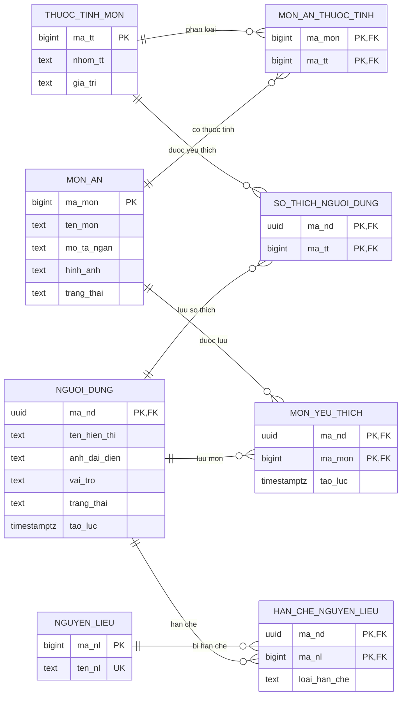
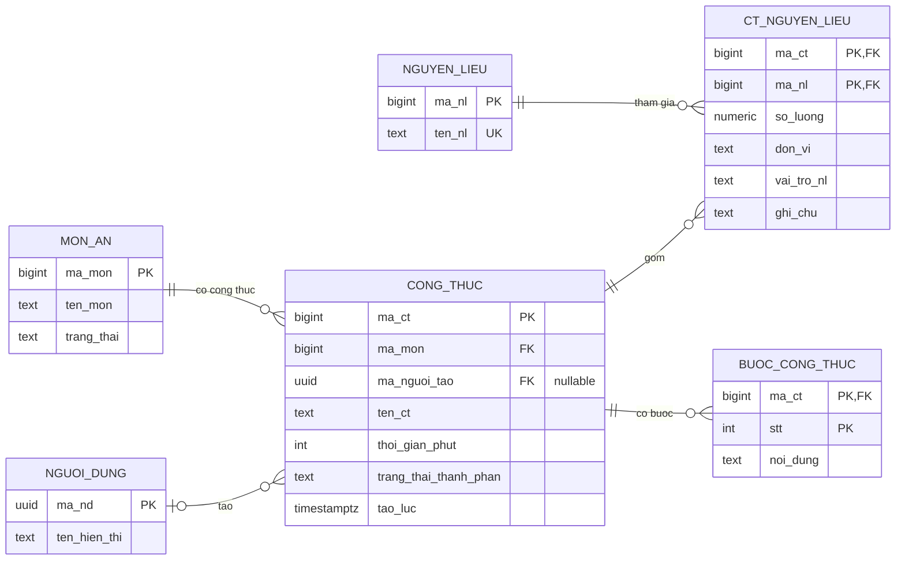
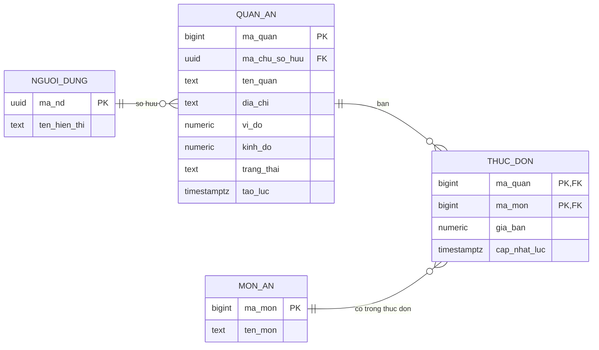
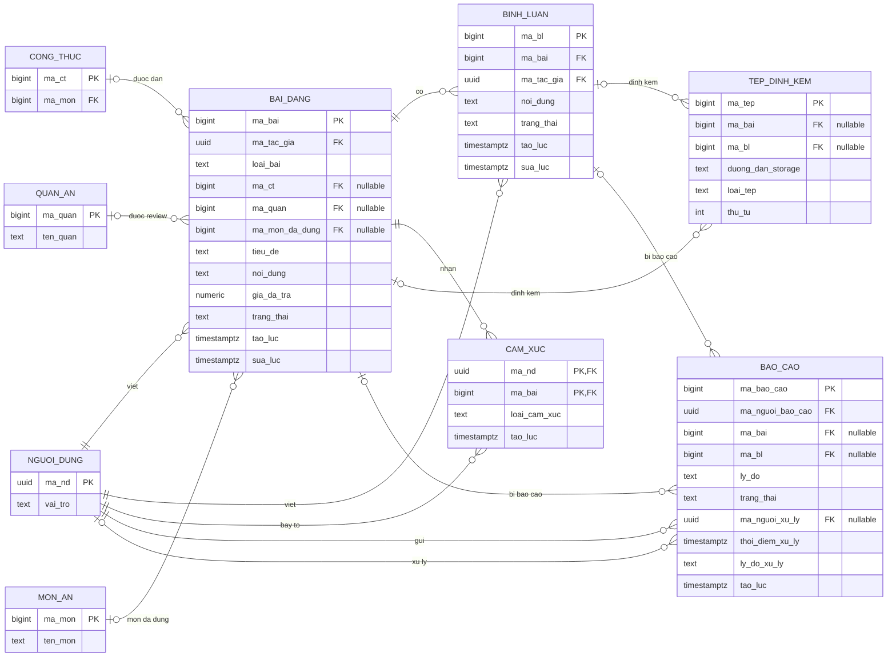

# Tài liệu ERD, quy tắc nghiệp vụ và ràng buộc toàn vẹn

**Hệ thống:** Hôm nay ăn gì?  
**Căn cứ:** Đề xuất dự án (`proposal (1)(3).html`) và lược đồ vật lý PostgreSQL/Supabase do nhóm cung cấp.  
**Phạm vi:** 18 bảng thuộc schema `public`, cùng tham chiếu tới `auth.users`.  
**Ngày lập:** 04/11/2026.

> **Quy ước nguồn và mức độ thực thi**
>
> - **[Đề xuất]**: quy định nêu trong proposal (QĐ 1.1–5.8).
> - **[DDL]**: ràng buộc thực sự xuất hiện trong các câu lệnh `CREATE TABLE` được cung cấp.
> - **[Cần bổ sung]**: yêu cầu nghiệp vụ chưa được bảo đảm bằng DDL hiện tại; có thể cần `CHECK`, `UNIQUE`, trigger, RLS hoặc xử lý API/ứng dụng.
> - ERD dưới đây phản ánh **mô hình dữ liệu vật lý hiện có**, không phải một thiết kế đã sửa. Nét quan hệ thể hiện FK; đối với FK nullable, phía tham chiếu có thể là 0 hoặc 1. Mermaid biểu diễn cardinality gần đúng nhưng **không thay cho constraint**.

## 1. Tổng quan mô hình dữ liệu

Hệ thống tổ chức dữ liệu theo năm nhóm nghiệp vụ:

| Nhóm | Bảng | Vai trò |
|---|---|---|
| Tài khoản và cá nhân hóa | `nguoi_dung`, `thuoc_tinh_mon`, `mon_an_thuoc_tinh`, `so_thich_nguoi_dung`, `mon_yeu_thich`, `han_che_nguyen_lieu` | Hồ sơ, sở thích, món yêu thích, dị ứng/kiêng kỵ |
| Danh mục và công thức | `mon_an`, `nguyen_lieu`, `cong_thuc`, `ct_nguyen_lieu`, `buoc_cong_thuc` | Danh mục món, nguyên liệu, công thức và từng bước |
| Địa điểm ăn uống | `quan_an`, `thuc_don` | Thông tin quán, chủ sở hữu, món bán và giá |
| Cộng đồng | `bai_dang`, `binh_luan`, `cam_xuc`, `tep_dinh_kem` | Bài công thức/review, tương tác, ảnh/video |
| Kiểm duyệt | `bao_cao` | Báo cáo vi phạm và lịch sử xử lý cơ bản |

**Lưu ý:** Có tổng cộng **18 bảng trong `public`**. `auth.users` là bảng hệ thống do Supabase Auth quản lý, không tính trong số 18 bảng.

## 2. Sơ đồ ERD (Crow's Foot / Mermaid)

Sơ đồ được tách theo phân hệ để tránh một ERD tổng thể quá chằng chịt. Tên bảng, thuộc tính, khóa và kiểu quan hệ lấy từ DDL. Các bảng xuất hiện ở nhiều sơ đồ chỉ là cùng một bảng được trình bày lại để dễ đọc.

### 2.1. Tài khoản, món ăn và cá nhân hóa

`nguoi_dung.ma_nd` đồng thời là FK một-một tới `auth.users.id` (bảng ngoài sơ đồ). Không có vai trò tài khoản `OWNER`: chủ quán được xác định bằng quan hệ tới từng quán ăn.

### 2.2. Công thức nấu ăn

Một món có thể có nhiều công thức. Mỗi công thức thuộc đúng một món; người tạo có thể để `NULL`. Trong DDL hiện tại, công thức có thể tồn tại mà chưa có nguyên liệu/bước (trạng thái `INCOMPLETE` giúp phân biệt dữ liệu chưa đầy đủ).

### 2.3. Quán ăn và thực đơn

Mỗi quán có **đúng một** người được ghi nhận là chủ sở hữu; một người có thể sở hữu nhiều quán. Mỗi cặp (quán, món) xuất hiện tối đa một lần trong thực đơn.

### 2.4. Cộng đồng và kiểm duyệt

> **Điểm quan trọng:** Các quan hệ `ma_ct`, `ma_quan`, `ma_mon_da_dung`, `ma_bai`, `ma_bl` trong những bảng liên quan **được khai báo có thể NULL riêng lẻ**. ERD trên **không có nghĩa** rằng ràng buộc loại bài đăng hoặc ràng buộc “chính xác một đối tượng” đã được áp dụng. Xem mục 5.

## 3. Lược đồ quan hệ và các khóa

Ký hiệu: **PK** = khóa chính; **FK** = khóa ngoại; **UQ** = duy nhất; `?` = có thể NULL. Các trường khác vẫn tồn tại theo DDL nhưng được rút gọn tại mục này; ERD đã thể hiện thuộc tính chính.

| Quan hệ | Khóa chính | Khóa ngoại | Khóa/điều kiện đáng chú ý |
|---|---|---|---|
| `nguoi_dung` | `ma_nd` | `ma_nd → auth.users(id)` | `vai_tro`, `trang_thai` theo tập giá trị |
| `mon_an` | `ma_mon` | — | Trạng thái ACTIVE/HIDDEN/DELETED |
| `thuoc_tinh_mon` | `ma_tt` | — | Chưa có UNIQUE (`nhom_tt`, `gia_tri`) |
| `mon_an_thuoc_tinh` | (`ma_mon`, `ma_tt`) | → `mon_an`, `thuoc_tinh_mon` | Không trùng cặp |
| `so_thich_nguoi_dung` | (`ma_nd`, `ma_tt`) | → `nguoi_dung`, `thuoc_tinh_mon` | Không trùng cặp |
| `mon_yeu_thich` | (`ma_nd`, `ma_mon`) | → `nguoi_dung`, `mon_an` | Không lưu trùng món |
| `nguyen_lieu` | `ma_nl` | — | `ten_nl` UNIQUE |
| `han_che_nguyen_lieu` | (`ma_nd`, `ma_nl`) | → `nguoi_dung`, `nguyen_lieu` | ALLERGY/AVOID; mỗi cặp chỉ một loại |
| `cong_thuc` | `ma_ct` | `ma_mon → mon_an`, `ma_nguoi_tao? → nguoi_dung` | `thoi_gian_phut > 0` nếu có |
| `ct_nguyen_lieu` | (`ma_ct`, `ma_nl`) | → `cong_thuc`, `nguyen_lieu` | `so_luong > 0` nếu có |
| `buoc_cong_thuc` | (`ma_ct`, `stt`) | `ma_ct → cong_thuc` | `stt > 0`, nội dung không rỗng |
| `quan_an` | `ma_quan` | `ma_chu_so_huu → nguoi_dung` | Vĩ độ [-90,90], kinh độ [-180,180] |
| `thuc_don` | (`ma_quan`, `ma_mon`) | → `quan_an`, `mon_an` | `gia_ban ≥ 0` |
| `bai_dang` | `ma_bai` | `ma_tac_gia → nguoi_dung`; `ma_ct? → cong_thuc`; `ma_quan? → quan_an`; `ma_mon_da_dung? → mon_an` | RECIPE/REVIEW; `noi_dung` không rỗng |
| `binh_luan` | `ma_bl` | `ma_bai → bai_dang`, `ma_tac_gia → nguoi_dung` | `noi_dung` không rỗng |
| `cam_xuc` | (`ma_nd`, `ma_bai`) | → `nguoi_dung`, `bai_dang` | LIKE/DISLIKE; một cảm xúc/người/bài |
| `tep_dinh_kem` | `ma_tep` | `ma_bai? → bai_dang`, `ma_bl? → binh_luan` | IMAGE/VIDEO; `thu_tu ≥ 0` |
| `bao_cao` | `ma_bao_cao` | `ma_nguoi_bao_cao → nguoi_dung`; `ma_bai? → bai_dang`; `ma_bl? → binh_luan`; `ma_nguoi_xu_ly? → nguoi_dung` | PENDING/RESOLVED/DISMISSED |

## 4. Quy tắc nghiệp vụ (đối chiếu proposal)

**Trạng thái** được ghi theo khả năng bảo đảm trong DDL hiện tại: **Có** = DDL đã bảo đảm phần cốt lõi; **Một phần** = chỉ bảo đảm một số điều kiện; **Chưa** = chưa có cơ chế bảo đảm trong DDL cung cấp. Chức năng frontend hoặc API đã xây dựng (nếu có) không được kiểm chứng tại đây.

### 4.1. Gợi ý món và công thức (QĐ 1.1–1.6)

| Mã | Quy tắc nghiệp vụ từ proposal | Dữ liệu/bảng liên quan | DDL hiện tại |
|---|---|---|---|
| QĐ 1.1 | Gợi ý món có thật, đủ tên/ảnh/mô tả; không lặp trong phiên; có thể quay lại đợt gợi ý trước. | `mon_an`; trạng thái phiên ở ứng dụng | **Một phần**: `ten_mon` NOT NULL; `hinh_anh`, `mo_ta_ngan` nullable; không có bảng lịch sử phiên. |
| QĐ 1.2 | Món phải thỏa mọi bộ lọc được chọn; không tự nới điều kiện khi không có kết quả. | `mon_an`, `mon_an_thuoc_tinh`, `cong_thuc` | **Chưa**: logic truy vấn/API. |
| QĐ 1.3 | Đăng nhập mới lưu sở thích/khám phá; ưu tiên món hợp sở thích; khám phá có ít nhất một thuộc tính ngoài sở thích. | `so_thich_nguoi_dung`, `thuoc_tinh_mon` | **Một phần**: có bảng sở thích; cần kiểm soát đăng nhập và thuật toán. |
| QĐ 1.4 | Quay lại màn hình không mất tiêu chí/danh sách gợi ý. | Trạng thái client/session | **Chưa**: không thuộc ràng buộc CSDL. |
| QĐ 1.5 | Công thức có thời gian, nguyên liệu/định lượng và các bước; thiếu phải thông báo rõ. | `cong_thuc`, `ct_nguyen_lieu`, `buoc_cong_thuc` | **Một phần**: có cấu trúc; thời gian, lượng và đơn vị có thể NULL; không bắt buộc phải có bước. |
| QĐ 1.6 | Phải đăng nhập mới lưu; mỗi món chỉ lưu một lần; món bị xóa hiển thị không còn tồn tại và có thể bỏ lưu. | `mon_yeu_thich`, `mon_an` | **Một phần**: PK cặp chống trùng; cần auth/RLS và xử lý món `DELETED`. |

### 4.2. Gợi ý địa điểm (QĐ 2.1–2.3)

| Mã | Quy tắc | Bảng | DDL hiện tại |
|---|---|---|---|
| QĐ 2.1 | Chỉ tra cứu địa điểm, không đặt món hoặc thanh toán. | `quan_an`, `thuc_don` | **Phù hợp phạm vi**: không có bảng đơn hàng/thanh toán. |
| QĐ 2.2 | Người đăng nhập được thêm quán; tên, địa chỉ, tọa độ bắt buộc; kiểm tra trùng vị trí gần đó. | `quan_an` | **Một phần**: NOT NULL, CHECK tọa độ; chưa chống trùng địa điểm hoặc kiểm soát quyền thêm. |
| QĐ 2.3 | Người thêm là chủ quán; chỉ chủ quán sửa thực đơn/giá; quyền chủ theo từng quán. | `quan_an`, `thuc_don` | **Một phần**: FK chủ sở hữu NOT NULL; chưa có chính sách chỉ chủ sửa; DDL không tự buộc chủ = người tạo request. |

### 4.3. Cộng đồng (QĐ 3.1–3.3)

| Mã | Quy tắc | Bảng | DDL hiện tại |
|---|---|---|---|
| QĐ 3.1 | Dùng chung nguồn dữ liệu công thức và review cho tra cứu/gợi ý. | `bai_dang`, `cong_thuc`, `quan_an` | **Một phần**: có FK liên kết; chưa ràng buộc nhất quán `loai_bai` và các FK. |
| QĐ 3.2 | Đăng nhập mới đăng/tương tác; nội dung không chỉ khoảng trắng; sửa giữ lượt tương tác và cập nhật thời gian; giao dịch lỗi không làm mất nội dung. | `bai_dang`, `binh_luan`, `cam_xuc` | **Một phần**: `noi_dung` được kiểm tra; PK cảm xúc giúp bảo toàn bản ghi; auth, cập nhật `sua_luc`, giao dịch cần bổ sung. |
| QĐ 3.3 | Bài HIDDEN/DELETED không vào bảng tin; không còn được tương tác; bài PUBLIC ai có link cũng xem được. | `bai_dang`, `binh_luan`, `cam_xuc` | **Một phần**: có trạng thái; chưa cưỡng chế chặn tương tác / chính sách đọc. |

### 4.4. Gợi ý theo nguyên liệu (QĐ 4.1–4.4)

| Mã | Quy tắc | Bảng | DDL hiện tại |
|---|---|---|---|
| QĐ 4.1 | Đầu vào đối sánh phải có ít nhất một nguyên liệu hợp lệ. | `nguyen_lieu`; đầu vào API | **Chưa**: validation tại API/UI. |
| QĐ 4.2 | Tính tỷ lệ nguyên liệu khớp có trọng số PRIMARY/SECONDARY; trả về nguyên liệu thiếu. | `ct_nguyen_lieu` | **Một phần**: lưu vai trò nguyên liệu; chưa định nghĩa công thức tính điểm/trọng số. |
| QĐ 4.3 | Loại công thức chứa nguyên liệu dị ứng/kiêng; loại trừ ưu tiên hơn điểm khớp. | `han_che_nguyen_lieu`, `ct_nguyen_lieu` | **Một phần**: có dữ liệu cấm; logic lọc cần thực hiện khi truy vấn. |
| QĐ 4.4 | Công thức thiếu thành phần phải đánh dấu chưa đầy đủ; không khẳng định an toàn/đủ nguyên liệu. | `cong_thuc.trang_thai_thanh_phan` | **Một phần**: có COMPLETE/INCOMPLETE, nhưng chưa ràng buộc trạng thái với danh sách thành phần thực tế. |

### 4.5. Tài khoản và quản trị (QĐ 5.1–5.8)

| Mã | Quy tắc | Bảng/dịch vụ | DDL hiện tại |
|---|---|---|---|
| QĐ 5.1 | Email hợp lệ/không trùng, mật khẩu đủ dài. | Supabase `auth.users` | **Ngoài DDL public**: cấu hình Supabase Auth. |
| QĐ 5.2 | Khách xem public; USER được đăng/tương tác/lưu/thêm quán; ADMIN quản trị; chủ quán là quyền theo quán. | `nguoi_dung`, `quan_an` | **Một phần**: `USER`/`ADMIN` đúng; quyền cần kiểm tra tại API/RLS. |
| QĐ 5.3 | Chỉ xem/sửa hồ sơ cá nhân; dữ liệu dị ứng/kiêng không công khai. | `nguoi_dung`, `han_che_nguyen_lieu` | **Chưa**: cần RLS hoặc backend authorization. |
| QĐ 5.4 | Mỗi người báo cáo mỗi nội dung tối đa một lần. | `bao_cao` | **Chưa**: chưa UNIQUE theo người + nội dung, chưa XOR đối tượng. |
| QĐ 5.5 | ADMIN kiểm duyệt; chỉ ẩn, không xóa vĩnh viễn; lưu người/thời điểm/lý do xử lý. | `bao_cao`, `bai_dang`, `binh_luan` | **Một phần**: có cột lưu xử lý và trạng thái; chưa bắt buộc metadata khi RESOLVED/DISMISSED; không có FK buộc người xử lý là ADMIN. |
| QĐ 5.6 | Người bị khóa không đăng nhập; ADMIN có thể mở khóa. | `nguoi_dung.trang_thai`, Auth | **Một phần**: có LOCKED nhưng Supabase Auth không tự chặn đăng nhập chỉ vì cột public này. |
| QĐ 5.7 | Sử dụng Supabase Auth và bảo vệ thông tin truy cập. | `auth.users`, `nguoi_dung` | **Một phần**: FK tới Auth; cần token verification, RLS, storage policies. |
| QĐ 5.8 | Ảnh/video hợp lệ (`jpg/png/webp/mp4`) và giới hạn dung lượng. | `tep_dinh_kem`, Supabase Storage | **Chưa**: `loai_tep` chỉ IMAGE/VIDEO, không chứng minh MIME thực tế hoặc dung lượng. |

## 5. Ràng buộc toàn vẹn dữ liệu

### 5.1. Toàn vẹn thực thể (đã có trong DDL)

- Mỗi bảng có khóa chính. Các bảng liên kết nhiều-nhiều dùng khóa ghép: `mon_an_thuoc_tinh`, `so_thich_nguoi_dung`, `mon_yeu_thich`, `han_che_nguyen_lieu`, `ct_nguyen_lieu`, `buoc_cong_thuc`, `thuc_don`, `cam_xuc`.
- Cặp (`ma_nd`, `ma_mon`) trong `mon_yeu_thich` duy nhất; (`ma_nd`, `ma_bai`) trong `cam_xuc` duy nhất; (`ma_quan`, `ma_mon`) trong `thuc_don` duy nhất.
- `nguyen_lieu.ten_nl` có `UNIQUE`; khóa ID dạng identity tự sinh ở các bảng được khai báo như vậy.

### 5.2. Toàn vẹn tham chiếu (đã có trong DDL)

- `nguoi_dung.ma_nd` phải tham chiếu một `auth.users.id` đang tồn tại.
- Mọi hàng liên kết sở thích, món yêu thích, hạn chế, thành phần, bước nấu, thực đơn, bình luận, cảm xúc đều tham chiếu cha tồn tại.
- Mỗi `cong_thuc.ma_mon` chỉ tới món hợp lệ; `ma_nguoi_tao` có thể NULL.
- Mỗi `quan_an.ma_chu_so_huu` chỉ tới người dùng hợp lệ.
- Mỗi `bai_dang.ma_tac_gia`, `binh_luan.ma_tac_gia`, `bao_cao.ma_nguoi_bao_cao` bắt buộc tham chiếu người dùng. Các FK tùy chọn chỉ bị kiểm tra khi khác NULL.
- DDL chưa khai báo `ON DELETE CASCADE` hay `ON DELETE SET NULL`: PostgreSQL mặc định `NO ACTION` đối với các FK này. Vì vậy xóa vật lý bản ghi cha có tham chiếu thường bị chặn (trừ trường hợp transaction xử lý hợp lệ); nên ưu tiên trạng thái xóa mềm theo đề xuất.

### 5.3. Toàn vẹn miền giá trị (đã có trong DDL)

| Bảng/cột | Miền cho phép |
|---|---|
| `nguoi_dung.vai_tro` | USER, ADMIN |
| `nguoi_dung.trang_thai` | ACTIVE, LOCKED |
| `mon_an.trang_thai`, `quan_an.trang_thai` | ACTIVE, HIDDEN, DELETED |
| `han_che_nguyen_lieu.loai_han_che` | ALLERGY, AVOID |
| `cong_thuc.trang_thai_thanh_phan` | COMPLETE, INCOMPLETE |
| `ct_nguyen_lieu.vai_tro_nl` | PRIMARY, SECONDARY |
| `bai_dang.loai_bai` | RECIPE, REVIEW |
| `bai_dang.trang_thai` | DRAFT, PUBLIC, HIDDEN, DELETED |
| `binh_luan.trang_thai` | PUBLIC, HIDDEN, DELETED |
| `cam_xuc.loai_cam_xuc` | LIKE, DISLIKE |
| `tep_dinh_kem.loai_tep` | IMAGE, VIDEO |
| `bao_cao.trang_thai` | PENDING, RESOLVED, DISMISSED |
| `cong_thuc.thoi_gian_phut` | > 0 nếu không NULL |
| `ct_nguyen_lieu.so_luong` | > 0 nếu không NULL |
| `buoc_cong_thuc.stt` | > 0 |
| `thuc_don.gia_ban`, `bai_dang.gia_da_tra` | ≥ 0 (giá đã trả có thể NULL) |
| `quan_an.vi_do`, `kinh_do` | [-90, 90] và [-180, 180] |
| `tep_dinh_kem.thu_tu` | ≥ 0 |
| Nội dung bài/bình luận/bước; lý do báo cáo | `length(btrim(...)) > 0` |

**Lưu ý về `CHECK` và NULL:** Trong PostgreSQL, biểu thức `CHECK` trả `UNKNOWN` (do giá trị `NULL`) vẫn được chấp nhận. Vì vậy điều kiện `so_luong > 0` không biến `so_luong` thành bắt buộc; tương tự cho `thoi_gian_phut`, `gia_da_tra`.
